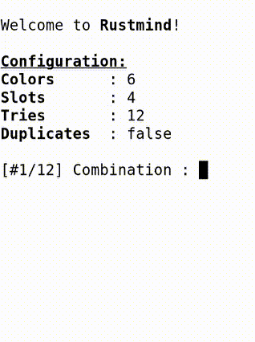

# Rustmind

  <picture>
    
  </picture>

## A 🄯LI game inspired by the Mastermind® game

The CLI is fully parameterizable, and comes with default values derived from the Mastermind® game:
- 6 colors
- 4 slots to discover
- 12 tries
- No duplicates

## Usage

**Usage**: **rustmind** [OPTIONS]

Options:
  **-c, --colors** \<COLORS\>              Number of allowed colors [default: 6]  
  **-s, --slots** \<SLOTS\>                Number of slots to find [default: 4]  
  **-t, --tries** \<TRIES\>                Number of allowed tries [default: 12]  
  **-u, --allow-duplicates**               Allow colors duplicates  
  **-d, --debug**                          Display diagnostic information  
  **-v, --verbose**                        Display verbose information  
  **-a, --answer** \<COMBINATION_ANSWER\>  Force the combination answer to the given value ([0-9a-fA-F]) - When this option is set, it overrides any other set options with values derived from the given combination  
  **-h, --help**                           Print help  
  **-V, --version**                        Print version  

## License

[GPL-3.0](./LICENSE)